# Dual-Grid Tileset Lab

[日本語](README.md) | **English**

> An implementation of **dual-grid autotiling**, where each tile looks at just 4 corners to pick 1 of 16 tiles.
> Every tile is **procedurally painted pixel art**. The project contains no image assets.

### ▶ [Play it in your browser (GitHub Pages)](https://kumi0708.github.io/dual-grid-tileset-lab/?lang=en)

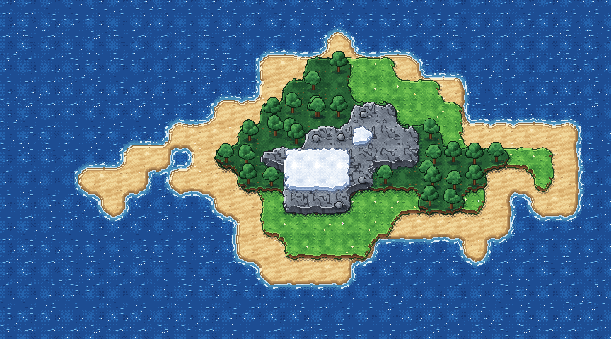

<sub>↑ Rendered by the code in this repository (animated PNG: the surf and water move).</sub>

---

## Contents

1. [Features](#features)
2. [What is a dual grid?](#what-is-a-dual-grid)
3. [How it works ① Two grids and a 4-bit mask](#how-it-works--two-grids-and-a-4-bit-mask)
4. [How it works ② Stacking 6 terrains as layers](#how-it-works--stacking-6-terrains-as-layers)
5. [How it works ③ Painting the tiles procedurally](#how-it-works--painting-the-tiles-procedurally)
6. [How it works ④ Hiding seams (periodic noise, variants, animation)](#how-it-works--hiding-seams)
7. [How it works ⑤ Decorations and rendering](#how-it-works--decorations-and-rendering)
8. [Architecture](#architecture)
9. [Controls](#controls)
10. [Running locally / regenerating images](#running-locally)
11. [Project layout](#project-layout)
12. [References](#references)

---

## Features

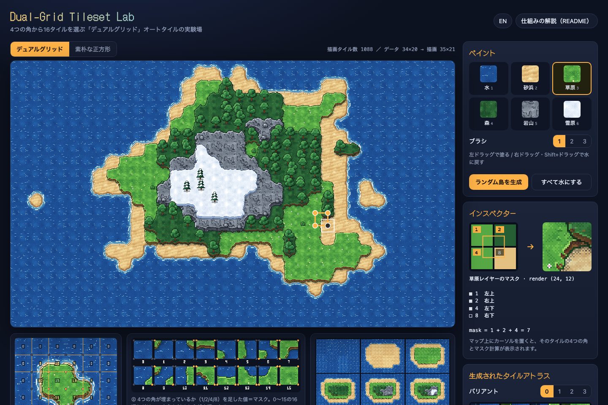

- **Paint and it connects.** Coastlines, cliffs, inner corners and diagonal contacts all get the right tile automatically.
- **6 terrains.** Water, sand, grass, forest, stone and snow, stacked as elevation-ordered layers.
- **Rich procedural pixel art.** Outlines, 3/4-view cliff faces, lit rims, cast shadows, animated surf, ordered dithering, and decoration sprites such as trees, pines and boulders.
- **A UI that shows the technique.** You can turn on the data grid, the render grid and the per-tile mask values. A live inspector shows the 4 corners under the cursor and how its mask is computed.
- **A "naive squares" mode** draws the same data without autotiling, for comparison.
- **Download the generated atlas as a PNG** and use it in your own game.
- Zero dependencies and no build step: plain ES modules and Canvas 2D.

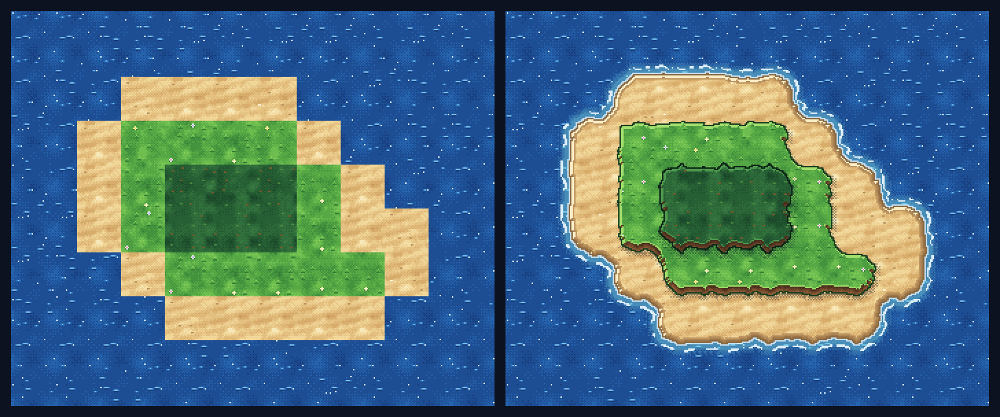

<sub>The same map data. **Left:** one square tile per cell (naive). **Right:** dual grid.</sub>

---

## What is a dual grid?

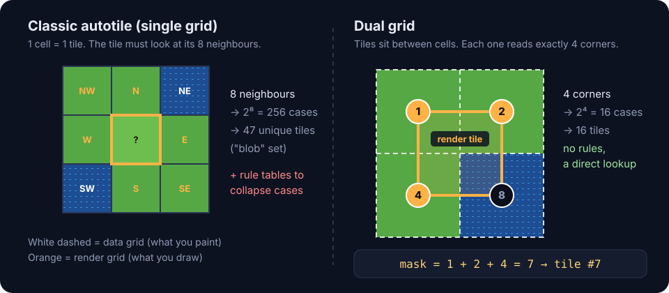

### The classic way (single grid / blob tiles)

Classic autotiling **places a tile on each painted cell** and picks its look from the **8 neighbours**.
That gives 2⁸ = **256 cases**. Merging the ones that look the same still leaves **47 tiles** (the "blob" set),
and you need rule tables to map the 256 cases onto them. With only the 4 edge neighbours you get 16 tiles,
but then **inner corners and diagonal contacts cannot be told apart**.

### The dual grid

A dual grid **offsets the grid you draw on by half a tile**.
Each render tile sits **on the corner shared by 4 cells** rather than inside a cell,
so all it needs to know is **whether each of those 4 corners is filled**.

- 4 bits → 2⁴ = **16 cases** → **16 tiles** (mask 0 is "nothing")
- No rule tables: **the mask is used directly as the atlas index**
- Inner corners and diagonals are among the 16 cases, so they come out right

---

## How it works ① Two grids and a 4-bit mask

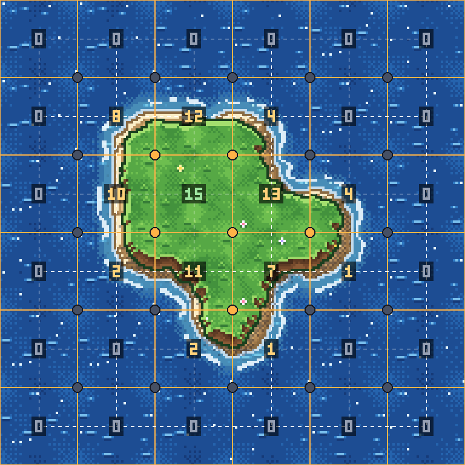

<sub>Dashed white = data grid (what you paint). Orange = render grid (where tiles are drawn).
Dots = data cell centres (orange = painted). Numbers = mask of each render tile.</sub>

### Coordinates

The data is a `W×H` grid of cells. Render tile `(rx, ry)` sits on the **shared corner** of these 4 cells:

```
 (rx-1, ry-1) = top-left    TL → bit 1     (rx, ry-1) = top-right    TR → bit 2
 (rx-1, ry  ) = bottom-left BL → bit 4     (rx, ry  ) = bottom-right BR → bit 8
```

```js
// src/dualgrid.js
export function cornerMask(map, rx, ry, layer) {
  let m = 0;
  if (map.get(rx - 1, ry - 1) >= layer) m |= 1; // TL
  if (map.get(rx,     ry - 1) >= layer) m |= 2; // TR
  if (map.get(rx - 1, ry    ) >= layer) m |= 4; // BL
  if (map.get(rx,     ry    ) >= layer) m |= 8; // BR
  return m;
}
```

- There are **`(W+1)×(H+1)` render tiles**. Tiles also sit on the outer corners of the map, so the render grid has one more column and one more row than the data.
  If you forget this, the border gets clipped. The demo shows it as "data 34×20 → render 35×21".
- Cells outside the map read as `0` (water).

### The 16 cases

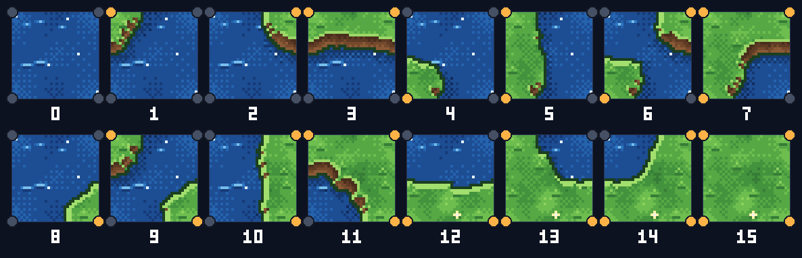

<sub>Orange corner dots = that corner's bit is set. Number = mask = atlas index.</sub>

Paint a single cell and the 4 render tiles around it each get one corner (8, 4, 2, 1). Together they form one round islet:

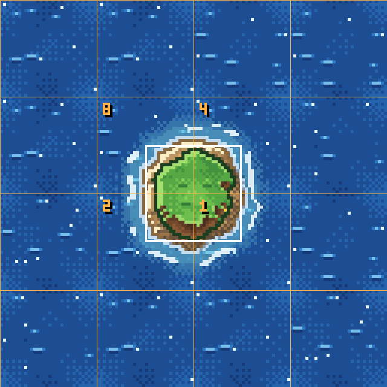

### Atlas layout

The atlas is a plain 4×4 sheet where **index = mask**.
If you use another layout, as the reference article does, add a `frameByMask[mask]` lookup table.
Variants are laid out horizontally and animation frames vertically.

```js
// src/tilegen.js
export function atlasRect(mask, variant, frame) {
  return { sx: (variant * 4 + (mask & 3)) * TILE, sy: (frame * 4 + (mask >> 2)) * TILE };
}
```

---

## How it works ② Stacking 6 terrains as layers

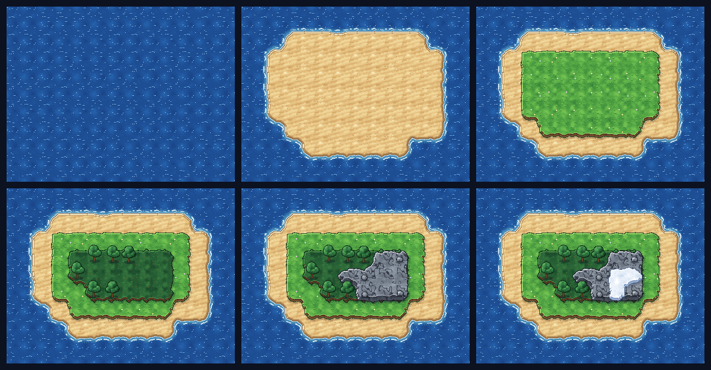

<sub>From top-left: water only → +sand → +grass → +forest → +stone → +snow.</sub>

The 16 dual-grid tiles describe a binary "terrain or not". To support several terrains, they are treated as
**elevation-ordered layers** (`0:water < 1:sand < 2:grass < 3:forest < 4:stone < 5:snow`).

- The mask of layer `L` uses the corners where **cell value ≥ L**.
- Layers are drawn bottom to top, skipping tiles whose mask is 0.
- Water (layer 0) is the **base layer**: it is always drawn with mask 15, everywhere.

When snow borders the sea, for example, rims of sand, grass and stone appear in between on their own.
You **don't need a transition tile set for every pair of terrains** (N×N). Each terrain needs only 16 tiles.

Each higher layer also adds a small `bias` to its threshold, which **shrinks it slightly**. The rims of the layers below then show like contour lines.

**Optimisation:** let `mn` be the minimum of the 4 corner values. Every layer up to `mn` has mask 15, which is fully opaque,
so drawing can start at `mn` and skip the hidden layers below it.

```js
const mn = Math.min(map.get(rx-1, ry-1), map.get(rx, ry-1), map.get(rx-1, ry), map.get(rx, ry));
for (let L = mn; L < terrains.length; L++) {
  const mask = terrains[L].base ? 15 : cornerMask(map, rx, ry, L);
  if (mask === 0) continue;
  blit(L, atlasRect(mask, variantAt(rx, ry, L), frame), rx * TILE, ry * TILE);
}
```

---

## How it works ③ Painting the tiles procedurally

**Every tile is drawn by code.** The project uses no image assets.
These are the generated atlases (variant 0 of each terrain):

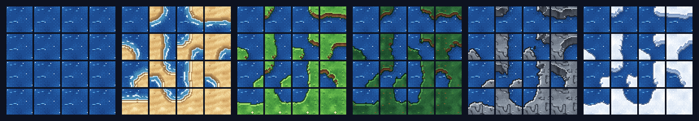

<sub>Left to right: water / sand / grass / forest / stone / snow. Each is 4×4 = 16 tiles, index = mask.</sub>

Each 32×32 tile goes through the pipeline below. The example is **stone, mask 7 (an inner corner)**:

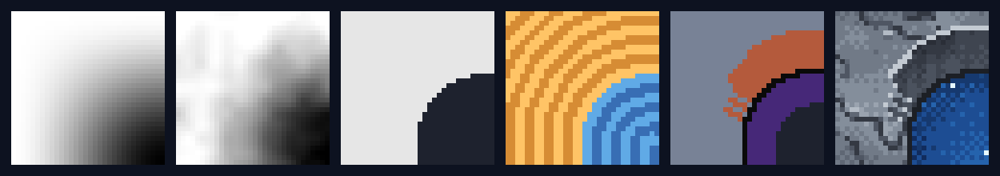

<sub>Left to right: (1) corner field → (2) + periodic noise → (3) threshold → (4) distance field (2px stripes) → (5) region classification (black = outline, brown = cliff face, yellow = lit rim, purple = cast shadow) → (6) final tile.</sub>

### (1) Corner field: from 4 bits to a continuous value

A smoothstep-weighted bilinear blend of the 4 corner bits gives a continuous scalar field over the tile.
It is 1 at filled corners and 0 at empty ones.

```js
export function cornerField(mask, u, v) {          // u, v ∈ [0,1] inside the tile
  const su = smooth(u), sv = smooth(v);
  return (mask & 1) * (1 - su) * (1 - sv) + ((mask >> 1) & 1) * su * (1 - sv)
       + ((mask >> 2) & 1) * (1 - su) * sv + ((mask >> 3) & 1) * su * sv;
}
```

The key property is that **the value on a tile edge depends only on the two corners at the ends of that edge**.
The neighbouring tile shares those two corners, so values on the edge always match.
With smoothstep the derivative across the edge is also 0, so contours don't kink at the seams.

### (2) Periodic noise: organic outlines

Noise is added to make the coastline ragged instead of straight.
The noise is value noise whose **period is exactly one tile**, so `noise(u, v) === noise(u + 1, v)`.
The right edge of any tile then has the same noise as the left edge of any other tile, and no arrangement can show a seam.

```js
// src/noise.js — wrap the lattice coordinates with period p
const x0 = wrap(xi, p), x1 = wrap(xi + 1, p);
```

### (3) Threshold

When `f = cornerField + noise - (0.5 + bias)` is positive the pixel is inside the terrain, and when it is negative the pixel is outside. `bias` shrinks the higher layers.

### (4) Distance field: 8SSEDT

Outlines, cliffs, rims and shadows all need to know how many pixels a pixel is from the edge.
The first version used the first-order estimate `f / |∇f|`. It underestimated distance wherever noise made the gradient steep, which left stray cliff pixels inside the shapes. The current version:

1. samples the field with a **10 px margin** around the tile. In the margin the corner blend is clamped and the noise is periodic, so it closely matches what the neighbouring tile really contains.
2. runs **8SSEDT** (a two-pass sequential Euclidean distance transform) on the inside/outside masks. This gives, for each pixel, the vector to the nearest pixel of opposite sign.

The result is an exact pixel distance `d` and a noise-robust **normal** pointing away from the edge, computed in O(N).

### (5) Terrain shaders: painting with distance and normal

A per-terrain "shader" function picks each pixel's colour from `d` (positive inside) and the inward normal `n`.
The light comes from the top-left.

| Region | Condition | Effect |
|---|---|---|
| Outline | `0 < d < 1.1` | dark 1 px outline |
| Cliff face (lip) | edge faces down (`-n.y > 0.25`) and `d < width` | 3/4-view cliff side: vertical striations on stone, dirt on grass |
| Lit rim | edge faces the light (`n·(0.6,0.8) > 0.35`) | bright highlight |
| Cast shadow | outside (`d < 0`) with the edge on the bottom-right | dithered translucent shadow |
| Surf / shallows (sand) | outside, `-9 < d < 0` | foam band that moves in and out, shallow-water tint |
| Surface | everything else | periodic noise and **4×4 Bayer dithering** pick a palette colour. Adds grass tufts, flowers, pebbles and cracks. |

```js
// src/terrains.js (excerpt)
if (c.d < 1.1) return o.outline;                         // outline
if (o.lip && front(c) > 0.25 && c.d < 1.1 + w) return o.lipShade(c, ...);  // cliff face
if (c.d < 2.6 && facing(c) > 0.35) return o.rim;         // lit rim
return o.surface(c);                                     // surface texture
```

Small marks such as grass tufts, flowers and pebbles are placed **inside the cells of an 8 px grid**, so they never cross a tile edge.

---

## How it works ④ Hiding seams

### Variants: windowed noise that changes only the interior

Rows of identical tiles show an obvious repeat. So each mask has **4 variants**, chosen by a hash of the render position.
Changing the noise naively would break the edges, so the variant noise is blended with a **window that is 0 on the edges and 1 in the centre**: `sin(πu)·sin(πv)`.

```js
export function vtex(u, v, p, oct, seed, variant, mix = 0.8) {
  const base = pfbm(u, v, p, oct, seed);                 // shared by all variants (edges match)
  if (!variant) return base;
  const w = edgeWindow(u, v) * mix;                      // 0 on edges, 1 in the centre
  return base * (1 - w) + pfbm(u, v, p, oct, seed + 1013 * variant) * w;
}
```

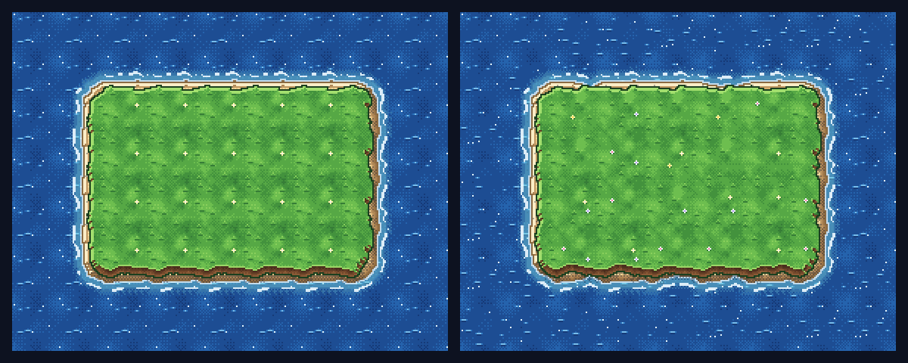

<sub>Left: every tile is variant 0, so a regular repeat shows. Right: hashed variants vary the outlines and textures.</sub>

The 4 variants of grass, mask 15. The edges are shared and only the interiors differ:

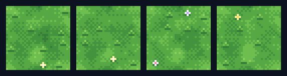

### Animation: scroll periodic noise by exactly one tile

Water and sand (surf) have 8 animation frames. The noise phase is shifted by `phase = frame / 8`.
After 8 frames it has moved by exactly one tile and is **back where it started**, so the loop is seamless.
The surf band's distance from the shore follows `sin(2π·phase + noise)`, so it moves in and out.

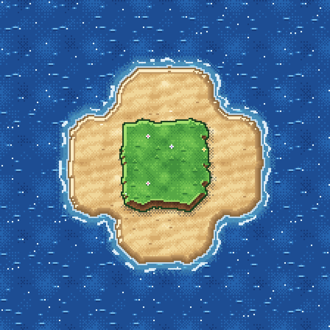

---

## How it works ⑤ Decorations and rendering

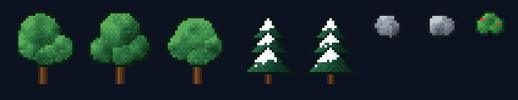

- Trees, pines, boulders and bushes are **procedural sprites**: unions of circles, shaded from the top-left and dithered.
- Decorations sit on **data cell centres**, which are render-grid corners. A hash jitters their positions, and they are **sorted by y** so nearer ones draw on top.
- Every forest cell gets trees. Snow and grass decorations go only where all 4 neighbours are at least as high, which keeps them off the coast.
- Terrain is rendered at 1× into an offscreen canvas and then **scaled up with nearest-neighbour** for display. Overlays (grids, mask numbers, inspector) are drawn at display resolution, so they stay crisp.
- The offscreen canvas is redrawn only **when the map changes** or **when the animation advances** (every 150 ms).

---

## Architecture

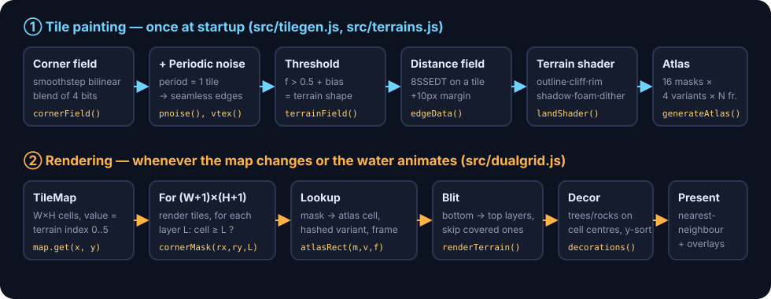

At startup every terrain atlas is generated: 16 masks × 4 variants × up to 8 frames. This takes about 0.3–0.6 s in a browser.

---

## Controls

| Input | Action |
|---|---|
| Left-drag | paint the selected terrain |
| Right-drag / Shift+drag | erase back to water |
| `1`–`6` | select terrain |
| Brush 1/2/3 | brush size |
| Dual grid / Naive squares | switch render mode (for comparison) |
| View → data grid / render grid / mask values | show how it works |
| Layers | toggle each terrain layer |
| Download atlas PNG | download the selected terrain's atlas (all variants and frames) |

URL parameters: `?lang=en`, `?overlay=data,render,mask`, `?mode=raw`, `?hover=24,12&brush=2` (for screenshots)

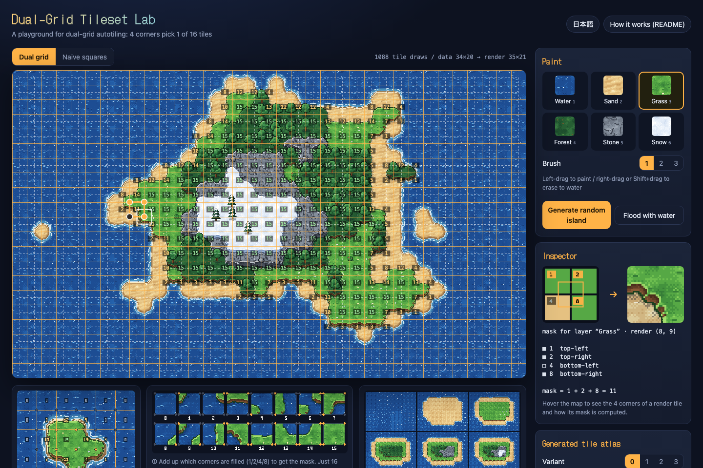

---

## Running locally

There is no build step. The code uses ES modules, so serve it over HTTP rather than opening it from `file://`:

```bash
node tools/serve.mjs 8000
```

→ http://localhost:8000

The README images (`docs/images/*.png`) are generated in Node from **the same source code** as the web demo.
The PNG/APNG encoder is in the repo too, so there are no dependencies:

```bash
node tools/build-docs.mjs
```

## Project layout

```
index.html, style.css      web UI
src/
  noise.js        hashing, tile-periodic noise pnoise/pfbm, world noise, Bayer matrix
  tilegen.js      corner field, windowed variants, 8SSEDT distance field, atlas generation
  terrains.js     palettes and pixel shaders for the 6 terrains
  sprites.js      tree / pine / boulder / bush sprite generation
  dualgrid.js     TileMap, cornerMask, layered rendering, decoration placement, island generator
  i18n.js         Japanese / English UI strings
  main.js         input, render loop, overlays, inspector
tools/
  build-docs.mjs  generates every README image
  raster.mjs      minimal raster ops for Node + PNG / APNG encoder
  serve.mjs       local static file server
docs/images/      generated images and SVG diagrams
```

## References

- [Dual-grid tilesets, explained — SpriteCook](https://www.spritecook.ai/blog/dual-grid-tilesets-explained).
  This project follows its corner bit order (TL=1, TR=2, BL=4, BR=8) and its warning that the render map is one tile larger than the data.
- 8SSEDT: the sequential-pass approach from Danielsson, *Euclidean distance mapping* (1980).

## License

MIT
