# Dual-Grid Tileset Lab

**日本語** | [English](README.en.md)

> 4つの角だけを見て16枚のタイルから1枚を選ぶ **「デュアルグリッド（Dual-Grid）」オートタイル** を、
> 画像ファイルを1枚も使わず **すべて手続き生成したピクセルアート** で実装したデモです。

### ▶ [ブラウザで遊ぶ（GitHub Pages）](https://kumi0708.github.io/dual-grid-tileset-lab/)

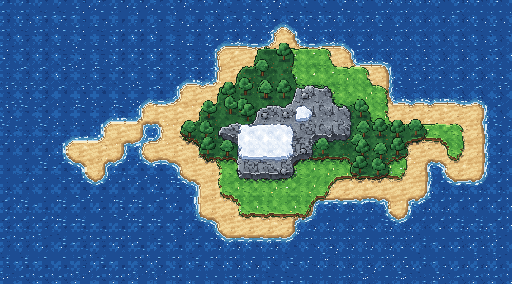

<sub>↑ 実際にこのリポジトリのコードでレンダリングした画像（APNGアニメーション。波打ち際の泡と水面が動きます）</sub>

---

## 目次

1. [できること](#できること)
2. [デュアルグリッドとは](#デュアルグリッドとは)
3. [仕組み① 2つのグリッドと4ビットのマスク](#仕組み-2つのグリッドと4ビットのマスク)
4. [仕組み② 6種類の地形をレイヤーで重ねる](#仕組み-6種類の地形をレイヤーで重ねる)
5. [仕組み③ タイル絵の手続き生成](#仕組み-タイル絵の手続き生成)
6. [仕組み④ 継ぎ目を消す工夫（周期ノイズ・バリアント・アニメ）](#仕組み-継ぎ目を消す工夫)
7. [仕組み⑤ 装飾とレンダリング](#仕組み-装飾とレンダリング)
8. [全体アーキテクチャ](#全体アーキテクチャ)
9. [操作方法](#操作方法)
10. [ローカルで動かす / 画像を再生成する](#ローカルで動かす)
11. [ファイル構成](#ファイル構成)
12. [参考](#参考)

---

## できること

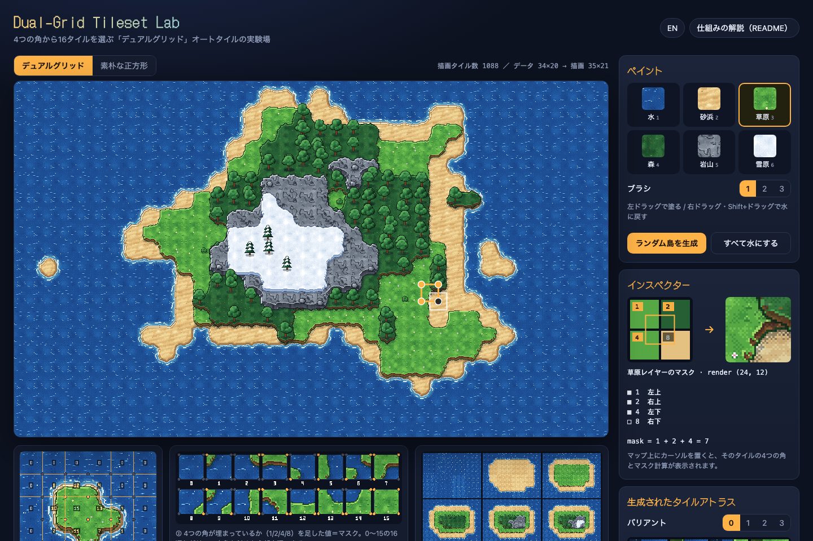

- **塗るだけで地形がつながる**：マス目を塗ると、海岸線・崖・内角・斜めの接続まで自動で正しいタイルが選ばれます。
- **6地形**：水 / 砂浜 / 草原 / 森 / 岩山 / 雪原。標高順のレイヤーとして重なります。
- **リッチな手続きピクセルアート**：アウトライン、崖の側面、光の当たる縁、落ち影、波打ち際の泡、ディザリング、木・岩・針葉樹などの装飾。
- **仕組みが見えるUI**：データグリッド／描画グリッドの表示、各タイルのマスク値の表示、カーソル下のタイルの4つの角とマスク計算をリアルタイムで解析。
- **「素朴な正方形」モード**と切り替えて、デュアルグリッドの効果を比較できます。
- 生成された**タイルアトラスを PNG でダウンロード**できます（他のゲームで使えます）。
- 依存ライブラリ0、ビルド不要。素の ES Modules + Canvas 2D だけで動きます。

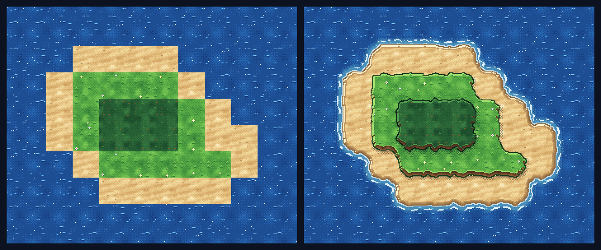

<sub>同じマップデータを、**左**は1マスに1枚の四角いタイル（素朴な方法）、**右**はデュアルグリッドで描いています。</sub>

---

## デュアルグリッドとは

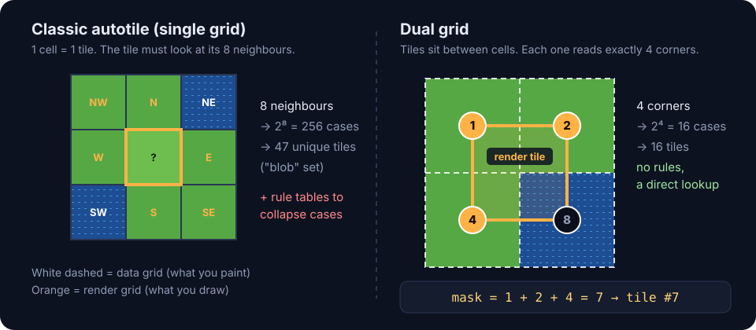

### 従来の方法（シングルグリッド / blob タイル）

普通のオートタイルは **「塗ったマスそのもの」にタイルを置き**、見た目を **周囲8マス** の状態で決めます。
8近傍は 2⁸ = **256通り**。見た目が同じものをまとめても **47枚**（いわゆる "blob" セット）が必要で、
256通りを47枚に畳み込むためのルール表も必要です。上下左右の4近傍だけにすると16枚で済みますが、
**内角（L字のへこみ）や斜めの接続を区別できません**。

### デュアルグリッド

デュアルグリッドでは、**タイルを描くグリッドを半マスずらします**。
描画タイルは「マスの中」ではなく **4つのマスが接する角の上** に乗るので、
そのタイルが見るべき情報は **4つの角（=4マス）が埋まっているかどうかだけ** になります。

- 4ビット → 2⁴ = **16通り** → **タイル16枚**（そのうちマスク0は「何もない」）
- ルール表は不要。**マスク値をそのまま配列のインデックスに使うだけ**
- 内角も斜めも、16通りの中に正確に含まれている

---

## 仕組み① 2つのグリッドと4ビットのマスク

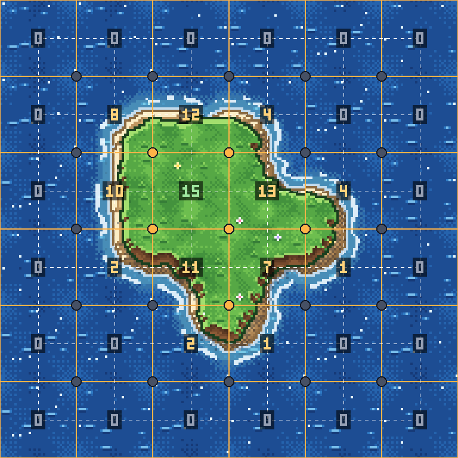

<sub>白い点線 = データグリッド（ユーザーが塗るマス）／ オレンジ = 描画グリッド（タイルを描く位置）／
丸 = データマスの中心（オレンジ=塗られている）／ 数字 = その描画タイルのマスク値</sub>

### 座標の対応

データは `W×H` のマス。描画タイル `(rx, ry)` は次の4マスの **共有点** に乗っています。

```
 (rx-1, ry-1) = 左上 TL → bit 1     (rx, ry-1) = 右上 TR → bit 2
 (rx-1, ry  ) = 左下 BL → bit 4     (rx, ry  ) = 右下 BR → bit 8
```

```js
// src/dualgrid.js
export function cornerMask(map, rx, ry, layer) {
  let m = 0;
  if (map.get(rx - 1, ry - 1) >= layer) m |= 1; // TL
  if (map.get(rx,     ry - 1) >= layer) m |= 2; // TR
  if (map.get(rx - 1, ry    ) >= layer) m |= 4; // BL
  if (map.get(rx,     ry    ) >= layer) m |= 8; // BR
  return m;
}
```

- 描画タイルは **`(W+1)×(H+1)` 枚**。マップの外周の角にもタイルが乗るので、データより1列・1行多くなります。
  これを忘れると外周が欠けます（デモ右上の「データ 34×20 → 描画 35×21」がこれ）。
- マップ外のマスは `0`（水）として扱います。

### 16通りのタイル

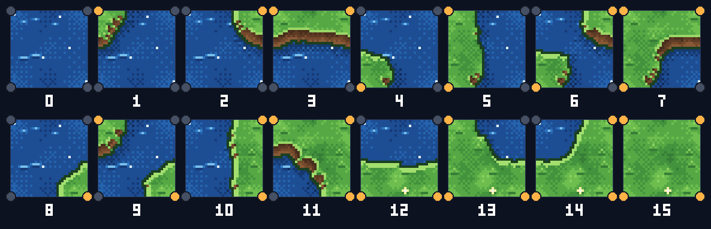

<sub>各タイルの四隅の丸がオレンジ = その角のビットが立っている。数字 = マスク値 = アトラス上のインデックス。</sub>

1マスだけ塗ると、その周りの4枚の描画タイルがそれぞれ別の角を持ち（8, 4, 2, 1）、合わせて1つの丸い島になります：

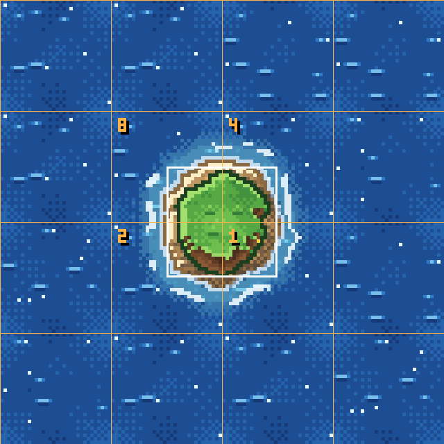

### アトラス配置

アトラスは **インデックス = マスク値** のシンプルな 4×4 配置にしています
（記事のように任意の配置を使う場合は `frameByMask[mask]` のルックアップ表を1段挟むだけです）。
さらにバリアントを横に、アニメーションフレームを縦に並べています。

```js
// src/tilegen.js
export function atlasRect(mask, variant, frame) {
  return { sx: (variant * 4 + (mask & 3)) * TILE, sy: (frame * 4 + (mask >> 2)) * TILE };
}
```

---

## 仕組み② 6種類の地形をレイヤーで重ねる

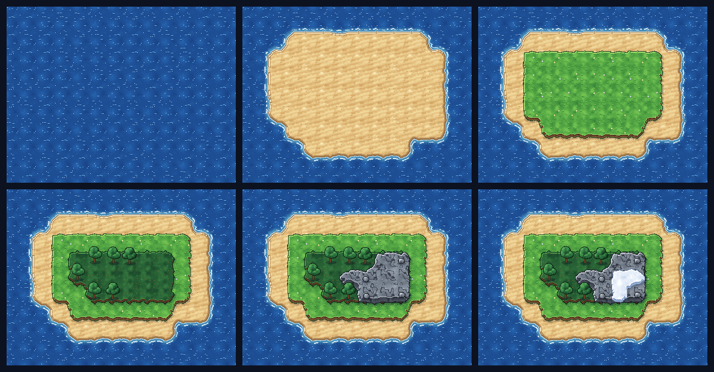

<sub>左上から：水だけ → +砂浜 → +草原 → +森 → +岩山 → +雪原</sub>

デュアルグリッドの16枚は本来「ある地形か／ないか」の2値です。複数の地形を扱うために、
地形を **標高順のレイヤー** とみなします（`0:水 < 1:砂浜 < 2:草原 < 3:森 < 4:岩山 < 5:雪原`）。

- レイヤー `L` のマスクは「**セルの値 ≥ L** の角」で計算する
- 下のレイヤーから順に、マスク0でないタイルを上書きで描いていく
- 水（レイヤー0）は **ベースレイヤー**：常にマスク15で全面に敷く

こうすると「雪原の隣が海」のような離れた地形同士でも、間に砂浜・草原・岩山の縁が自然に挟まり、
**地形の組み合わせごとの遷移タイル（N×N通り）を用意する必要がありません**。各地形 16枚 × 6 で済みます。

さらに、上のレイヤーほどしきい値に `bias` を足して **わずかに内側へ縮める** ことで、
下のレイヤーの縁が等高線のように少しずつ見えるようにしています。

**最適化：** 4つの角の最小値を `mn` とすると、`mn` 以下のレイヤーは全部マスク15（完全に不透明）です。
なので `mn` から描き始めれば、見えない下のレイヤーを描かずに済みます。

```js
const mn = Math.min(map.get(rx-1, ry-1), map.get(rx, ry-1), map.get(rx-1, ry), map.get(rx, ry));
for (let L = mn; L < terrains.length; L++) {
  const mask = terrains[L].base ? 15 : cornerMask(map, rx, ry, L);
  if (mask === 0) continue;
  blit(L, atlasRect(mask, variantAt(rx, ry, L), frame), rx * TILE, ry * TILE);
}
```

---

## 仕組み③ タイル絵の手続き生成

このプロジェクトのタイルは **すべてコードで描いています**（画像素材ゼロ）。
生成されるアトラス（各地形のバリアント0）：

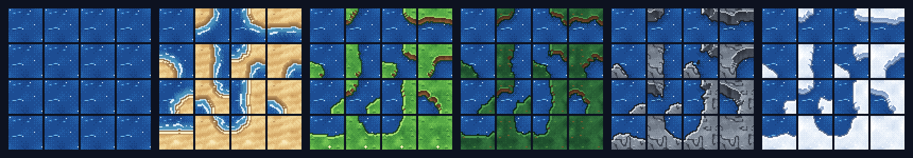

<sub>左から 水 / 砂浜 / 草原 / 森 / 岩山 / 雪原。各 4×4 = 16枚、インデックス = マスク。</sub>

1枚のタイル（32×32px）は、次のパイプラインで描かれます。下の図は **岩山・マスク7（内角）** の各段階です：

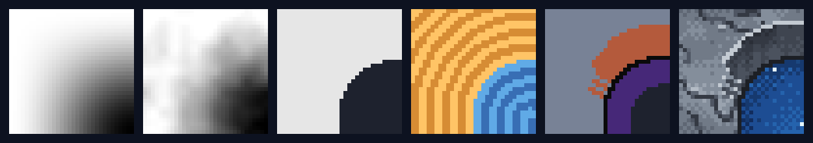

<sub>左から：(1) コーナー場 → (2) +周期ノイズ → (3) しきい値で形 → (4) 距離場（2pxごとの縞） → (5) 領域分類（黒=輪郭, 茶=崖面, 黄=光の当たる縁, 紫=落ち影） → (6) 完成</sub>

### (1) コーナー場 — 4ビットを連続値に

4つの角のビットを smoothstep 補間した双線形補間で、タイル内の連続したスカラー場にします。
角が埋まっていれば1、空なら0。

```js
export function cornerField(mask, u, v) {          // u, v ∈ [0,1] はタイル内座標
  const su = smooth(u), sv = smooth(v);
  return (mask & 1) * (1 - su) * (1 - sv) + ((mask >> 1) & 1) * su * (1 - sv)
       + ((mask >> 2) & 1) * (1 - su) * sv + ((mask >> 3) & 1) * su * sv;
}
```

ポイントは **タイルの辺上の値が「その辺の両端の2つの角」だけで決まる** こと。
隣のタイルは同じ2つの角を共有しているので、辺の上で値が必ず一致します。
さらに smoothstep により辺の上で微分も0になるため、境界線がタイルの継ぎ目で折れません。

### (2) 周期ノイズ — 有機的な輪郭

まっすぐな輪郭ではつまらないので、ノイズを足して海岸線をギザギザにします。
ここで使うノイズは **周期がちょうど1タイル**（`noise(u, v) === noise(u + 1, v)`）のバリューノイズです。
どのタイルの右端も、どのタイルの左端と同じノイズ値になるので、どう並べても継ぎ目が出ません。

```js
// src/noise.js — 格子座標を周期 p で wrap するだけ
const x0 = wrap(xi, p), x1 = wrap(xi + 1, p);
```

### (3) しきい値

`f = cornerField + noise - (0.5 + bias)` が正なら地形の内側、負なら外側です。`bias` で上のレイヤーを少し縮めます。

### (4) 距離場 — 8SSEDT

輪郭線・崖・縁取り・影を描くには「この画素は輪郭から何px離れているか」が必要です。
最初は `f / |∇f|`（1次近似）を使っていましたが、ノイズで勾配が大きい場所で距離を過小評価し、
内部に崖のゴミが出ました。そこで

1. タイルの周囲に **10px の余白** を付けて場をサンプリング（余白部分はコーナー場がクランプされ、ノイズは周期的なので、隣のタイルの実際の中身とほぼ一致する）
2. 内側／外側の2値画像に **8SSEDT（2パスの逐次ユークリッド距離変換）** をかけて、各画素から「反対側の一番近い画素」へのベクトルを求める

ことで、正確なピクセル距離 `d` と、ノイズに強い **法線（輪郭から遠ざかる向き）** を O(N) で得ています。

### (5) 地形シェーダー — 距離と法線で塗り分け

`d`（内側が正）と内向き法線 `n` を使って、地形ごとの「シェーダー」関数が1画素ずつ色を決めます。
光源は左上。

| 領域 | 条件 | 効果 |
|---|---|---|
| 輪郭 | `0 < d < 1.1` | 暗い1pxのアウトライン |
| 崖面（リップ） | 輪郭が下向き（`-n.y > 0.25`）かつ `d < 幅` | 3/4見下ろしの崖の側面。岩山は縦の筋、草原は土 |
| 光の縁 | 輪郭が光の方を向く（`n·(0.6,0.8) > 0.35`） | 明るいハイライト |
| 落ち影 | 外側 `d < 0` で輪郭が右下側 | ディザリングした半透明の影 |
| 泡・浅瀬（砂浜） | 外側 `-9 < d < 0` | 寄せては返す泡の帯、浅瀬の色 |
| 表面 | それ以外 | 周期ノイズ＋ **4×4 Bayer ディザリング** でパレットを選ぶ。草の房・花・小石・亀裂など |

```js
// src/terrains.js（抜粋）
if (c.d < 1.1) return o.outline;                         // アウトライン
if (o.lip && front(c) > 0.25 && c.d < 1.1 + w) return o.lipShade(c, ...);  // 崖面
if (c.d < 2.6 && facing(c) > 0.35) return o.rim;         // 光の当たる縁
return o.surface(c);                                     // 表面テクスチャ
```

「草の房」「花」「小石」のような小さな模様は **8px グリッドのセル内に収まるように** 配置しているので、タイルの辺をまたぎません。

---

## 仕組み④ 継ぎ目を消す工夫

### バリアント：窓関数で「中だけ違う」タイルを作る

同じタイルが並ぶと繰り返しが目立ちます。そこで各マスクについて **4つのバリアント** を作り、
描画位置のハッシュで選んでいます。ただし普通にノイズを変えると辺が合わなくなるので、
**辺で0、中央で1になる窓関数** `sin(πu)·sin(πv)` でブレンドします。

```js
export function vtex(u, v, p, oct, seed, variant, mix = 0.8) {
  const base = pfbm(u, v, p, oct, seed);                 // 全バリアント共通（辺で一致）
  if (!variant) return base;
  const w = edgeWindow(u, v) * mix;                      // 辺 = 0, 中央 = 1
  return base * (1 - w) + pfbm(u, v, p, oct, seed + 1013 * variant) * w;
}
```

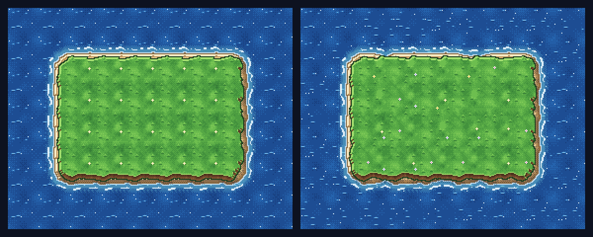

<sub>左：全タイル同じ → 規則的な繰り返しが見える。右：ハッシュでバリアントを選択 → 輪郭も模様もばらける。</sub>

草原・マスク15の4つのバリアント（辺の部分は共通、中央だけが違う）：

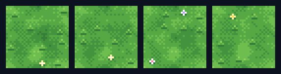

### アニメーション：周期ノイズをちょうど1タイル分スクロール

水と砂浜（泡）は8フレームのアニメーションを持ちます。ノイズの位相を `phase = frame / 8` だけずらすと、
8フレームでちょうど1タイル分ずれて **元に戻る** ので、継ぎ目なくループします。
泡の帯は `sin(2π·phase + noise)` で岸からの距離が変わり、寄せては返す動きになります。

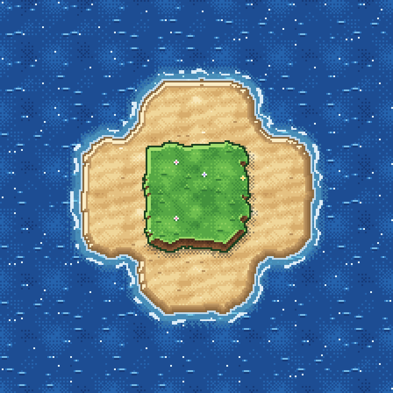

---

## 仕組み⑤ 装飾とレンダリング

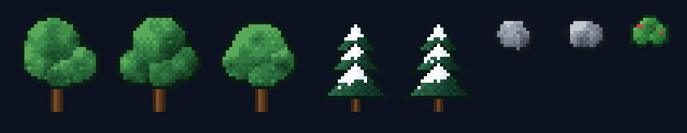

- 木・針葉樹・岩・茂みも **手続き生成のスプライト** です（円の和で作った形を、左上からの光で陰影付け＋ディザリング）。
- 装飾は **データマスの中心**（=描画グリッドの角）に置き、ハッシュで位置をずらし、**y座標でソート** して手前のものが上に描かれるようにしています。
- 森のマスには必ず木を、雪原・草原は「4近傍がすべて同じ地形以上」の内側にだけ置くことで、海岸に木が飛び出さないようにしています。
- 描画は 1倍サイズのオフスクリーンキャンバスに行い、表示用キャンバスへ **ニアレストネイバーで拡大** して表示。グリッド・マスク値・インスペクターなどのオーバーレイは拡大後の解像度で描くのでくっきりします。
- オフスクリーンの再描画は **マップが変わったとき** と **アニメのフレームが進んだとき（150ms毎）** だけです。

---

## 全体アーキテクチャ

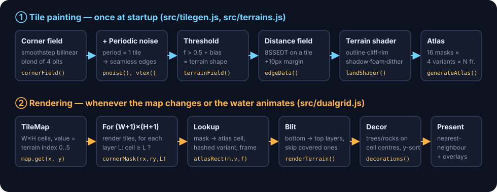

起動時にすべての地形のアトラス（16マスク × 4バリアント × 最大8フレーム）を生成します。ブラウザでも約0.3〜0.6秒です。

---

## 操作方法

| 操作 | 内容 |
|---|---|
| 左ドラッグ | 選択中の地形で塗る |
| 右ドラッグ / Shift+ドラッグ | 水に戻す |
| `1`〜`6` キー | 地形を選択 |
| ブラシ 1/2/3 | ブラシサイズ |
| デュアルグリッド / 素朴な正方形 | 描画方式の切り替え（比較用） |
| 表示 → データグリッド / 描画グリッド / マスク値 | 仕組みの可視化 |
| レイヤー | 各地形レイヤーの表示/非表示 |
| アトラスPNGを保存 | 選択中の地形のアトラス（全バリアント・全フレーム）をダウンロード |

URLパラメータ：`?lang=en`（英語UI）、`?overlay=data,render,mask`、`?mode=raw`、`?hover=24,12&brush=2`（スクリーンショット用）

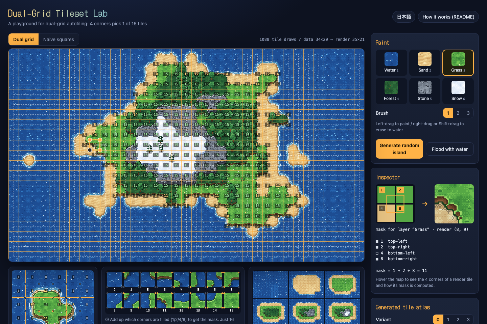

---

## ローカルで動かす

ビルドは不要です。ES Modules を使うので、`file://` ではなく HTTP サーバー経由で開いてください。

```bash
node tools/serve.mjs 8000
```

→ http://localhost:8000

README の画像（`docs/images/*.png`）は、Webデモと **同じソースコード** から Node で生成しています（PNG/APNG エンコーダーも自前、依存なし）：

```bash
node tools/build-docs.mjs
```

## ファイル構成

```
index.html, style.css      Web UI
src/
  noise.js        ハッシュ、タイル周期ノイズ pnoise/pfbm、ワールドノイズ、Bayer 行列
  tilegen.js      コーナー場、窓関数バリアント、8SSEDT 距離場、アトラス生成
  terrains.js     6地形のパレットとピクセルシェーダー
  sprites.js      木・針葉樹・岩・茂みのスプライト生成
  dualgrid.js     TileMap、cornerMask、レイヤー描画、装飾配置、島の自動生成
  i18n.js         日本語 / 英語の UI 文字列
  main.js         入力、描画ループ、オーバーレイ、インスペクター
tools/
  build-docs.mjs  README 用の画像をすべて生成
  raster.mjs      Node 用の最小ラスタ処理 + PNG / APNG エンコーダー
  serve.mjs       ローカル用の静的ファイルサーバー
docs/images/      生成された画像と SVG の図
```

## 参考

- [Dual-grid tilesets, explained — SpriteCook](https://www.spritecook.ai/blog/dual-grid-tilesets-explained)
  （角のビット順 TL=1, TR=2, BL=4, BR=8 と「描画マップは1タイル大きい」という注意点はこの記事に従っています）
- 8SSEDT: Danielsson, *Euclidean distance mapping* (1980) の逐次パス方式

## ライセンス

MIT
